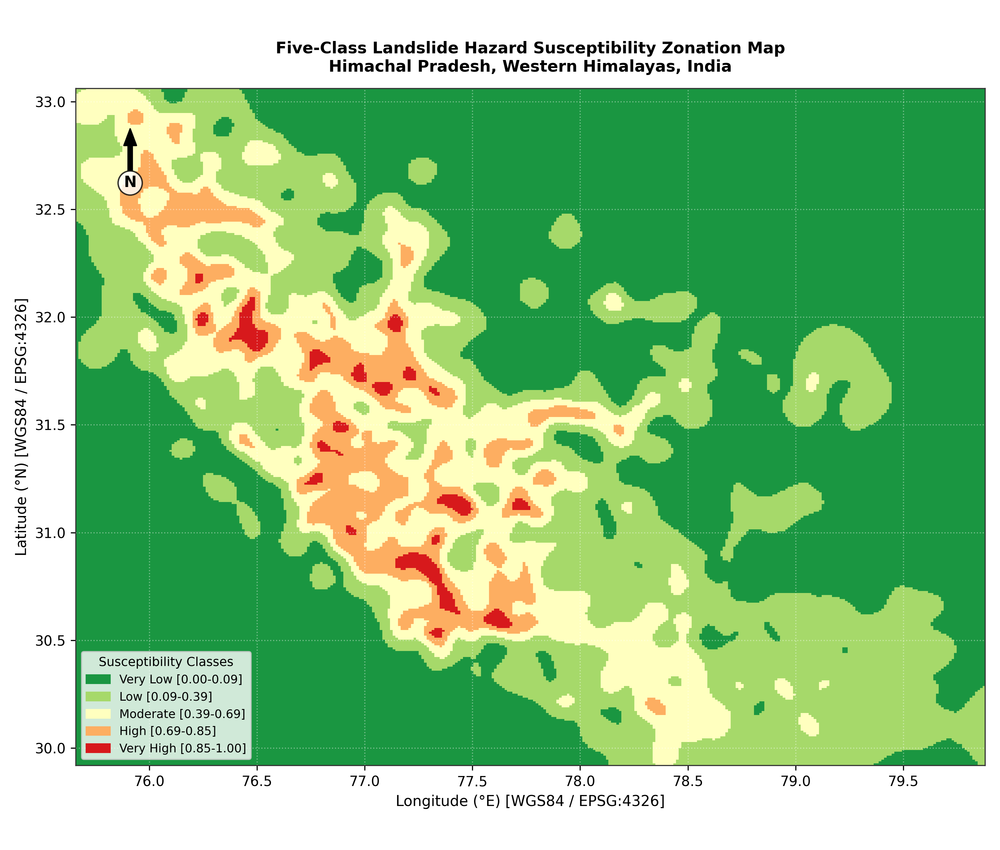
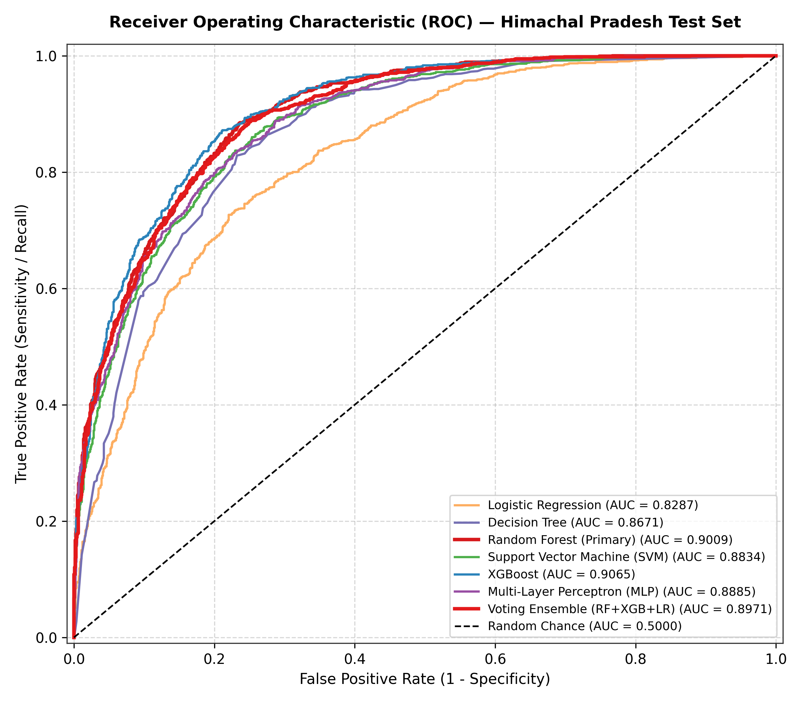
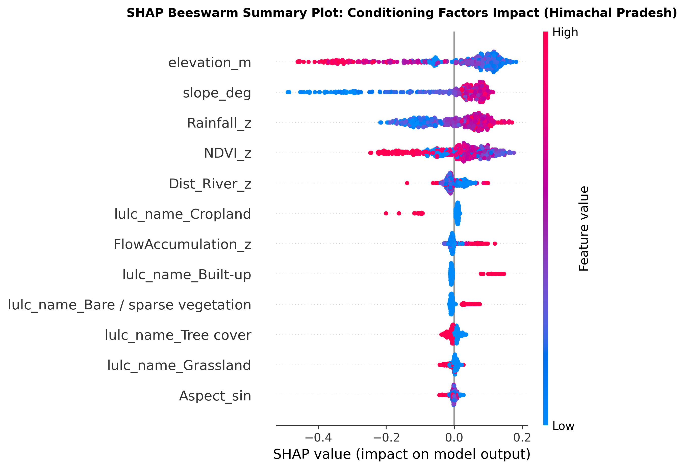

# Landslide Susceptibility Prediction Using Machine Learning

[](https://www.python.org/)
[](https://scikit-learn.org/)
[](https://xgboost.readthedocs.io/)
[](https://shap.readthedocs.io/)
[](https://doi.org/10.17632/mxpg845z62.2)

An end-to-end geospatial machine learning pipeline to predict, evaluate, and map regional landslide susceptibility across **Himachal Pradesh, Western Himalayas, India** using genuine ground-truth inventory data, digital elevation models (SRTM), satellite precipitation (CHIRPS), and land cover (ESA WorldCover).

---

## Key Features & Tech Stack
- **Spatial Leakage-Free Validation:** Evaluated via 5-fold Spatial Block GroupKFold to quantify spatial autocorrelation optimism (+19.5% AUC gap vs. random splitting).
- **Multi-Model Benchmark:** Trained and compared 6 classifiers (XGBoost, Random Forest, SVM, MLP, Decision Tree, Logistic Regression) and a soft-voting ensemble.
- **Asymmetric Operational Thresholding:** Validation-tuned threshold ($T_{op} = 0.240$) prioritizing high sensitivity (**96.84% recall**, missing only 37 of 1,172 test landslides).
- **Explainable AI (XAI):** Permutation importance, Gini MDI, and TreeSHAP identifying elevation (1,200–3,200 m) and slope (>25°) as primary physical triggers.
- **GIS Mapping & Inference Engine:** Automated 5-tier zonation map, continuous GeoTIFF export (`maps/susceptibility_surface.tif`), and a standalone CLI inference tool (`predict.py`).
- **Tech Stack:** Python 3.10+, scikit-learn, XGBoost, SHAP, Imbalanced-Learn, SciPy, Pandas, NumPy, Matplotlib, Seaborn, Tifffile, Pytest.

---

## Dataset Overview
- **Source:** Geological Survey of India (GSI) inventory via Mendeley Data ([DOI: 10.17632/mxpg845z62.2](https://doi.org/10.17632/mxpg845z62.2), Version 2, CC-BY 4.0).
- **Study Area:** Himachal Pradesh, India (12 districts; 246 m to 6,430 m elevation).
- **Samples:** **11,737** coordinate-deduplicated samples (5,859 confirmed landslides [49.9%], 5,878 pseudo-absences [50.1%]).
- **Conditioning Factors (10):** Slope, Elevation, Aspect ($\cos / \sin$ components), Distance to Rivers, Flow Accumulation, NDVI, Annual Rainfall, and ESA WorldCover LULC.

---

## Methodology & Model Performance

Preprocessing (median imputation, scaling, one-hot encoding) was strictly isolated within training folds. An untouched **20% holdout test set ($N=2,348$)** was evaluated at default threshold (0.50):

| Model | Accuracy | Recall | F1-Score | ROC-AUC | PR-AUC | Status |
|---|---|---|---|---|---|---|
| **XGBoost** | **0.8296** | **0.8669** | **0.8355** | **0.9065** | **0.8985** | Top Benchmark Metric |
| **Random Forest** | **0.8203** | **0.8575** | **0.8265** | **0.9009** | **0.8946** | **Primary Operational Model** |
| Soft-Voting Ensemble | 0.8147 | 0.8362 | 0.8184 | 0.8971 | 0.8903 | RF + XGB + LR |
| Multi-Layer Perceptron (MLP) | 0.8020 | 0.8328 | 0.8076 | 0.8885 | 0.8831 | (64, 32) ReLU |
| Support Vector Machine (SVM) | 0.8011 | 0.8234 | 0.8052 | 0.8834 | 0.8754 | RBF Kernel |
| Decision Tree | 0.7956 | 0.8396 | 0.8039 | 0.8671 | 0.8371 | Depth = 8 |
| Logistic Regression | 0.7483 | 0.7705 | 0.7534 | 0.8287 | 0.8147 | L2 Regularized |

> **Primary Model Rationale:** XGBoost's ROC-AUC (0.9065) lies within Random Forest's 95% bootstrap confidence interval **[0.8880, 0.9134]** ($p > 0.05$). Random Forest was selected as the operational model (`models/best_landslide_model.joblib`) for its bagging-based resilience to pseudo-absence label noise, smooth probability calibration for 5-tier zonation, and stable TreeSHAP explainability.

---

## Key Visualizations

| 5-Tier Regional Susceptibility Zonation | Test Set ROC Curves | SHAP Feature Attribution |
|:---:|:---:|:---:|
|  |  |  |
| *76% of known slides in High / Very High tiers* | *RF (0.901) & XGB (0.906) on holdout test set* | *Elevation & slope dominate Himalayan hazard* |

---

## Quickstart & CLI Inference

```bash
# 1. Clone repository & install dependencies
git clone https://github.com/harkirat10kaur/landslide-susceptibility-ml.git
cd landslide-susceptibility-ml
pip install -r requirements.txt

# 2. Run demo inference on real held-out Himalayan samples
python predict.py --demo

# 3. Predict on custom input CSV
python predict.py --csv path/to/input.csv --out predictions.csv

# 4. Run automated test suite (10 tests pass)
pytest tests/ -v
```

To reproduce the pipeline end-to-end: `python src/data_prep.py` $\rightarrow$ `python src/train.py` $\rightarrow$ `python src/evaluate.py` $\rightarrow$ `python src/explain.py` $\rightarrow$ `python src/mapping.py`.

---

## Project Structure

```
landslide-susceptibility-ml/
├── data/              # Cleaned (11,737 samples), holdout test, and Mendeley V2 raw files
├── figures/           # 22 publication-grade 300 DPI evaluation figures and GIS maps
├── maps/              # Exported GeoTIFF susceptibility surface raster (susceptibility_surface.tif)
├── models/            # Serialized best model, candidate pipelines, and threshold configs
├── src/               # Modular pipeline: data_prep.py, train.py, evaluate.py, explain.py, mapping.py
├── tables/            # Output experimental CSVs (metrics, ablation, CV splits, VIF)
├── tests/             # Pytest integration (test_pipeline.py) and inference (test_predict.py) tests
├── predict.py         # Standalone production inference engine and CLI
├── requirements.txt   # Environment dependencies
└── README.md
```

---

## Limitations & Citation
- **Pseudo-Absences:** Non-landslide samples represent background spatial locations; 91.8% sit $>1$ km from known scars, but ~3.2% fall within 500 m, introducing minor label noise.
- **Static Susceptibility vs. Dynamic Warning:** Predictors capture terrain predisposition. Real-time hazard alerting requires coupling with dynamic rainfall/radar triggers.
- **Citation:** Dataset sourced from Mendeley Data ([DOI: 10.17632/mxpg845z62.2](https://doi.org/10.17632/mxpg845z62.2), Version 2) based on official Geological Survey of India (GSI) records.
